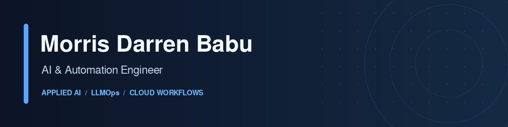
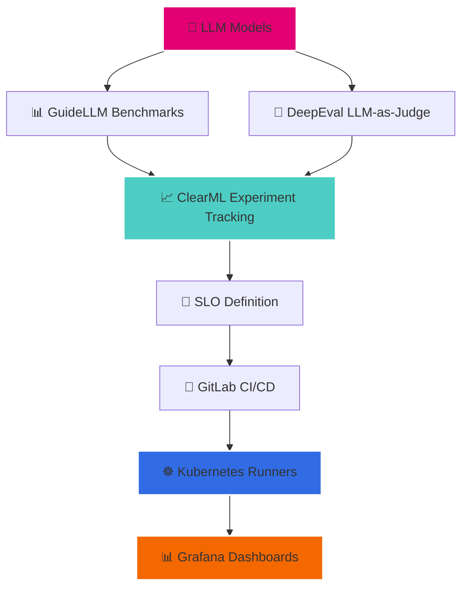
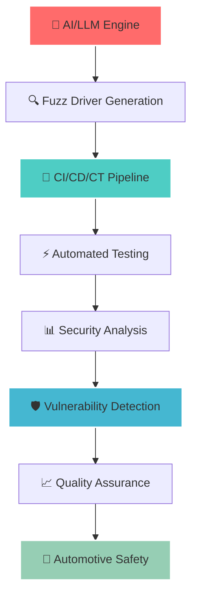
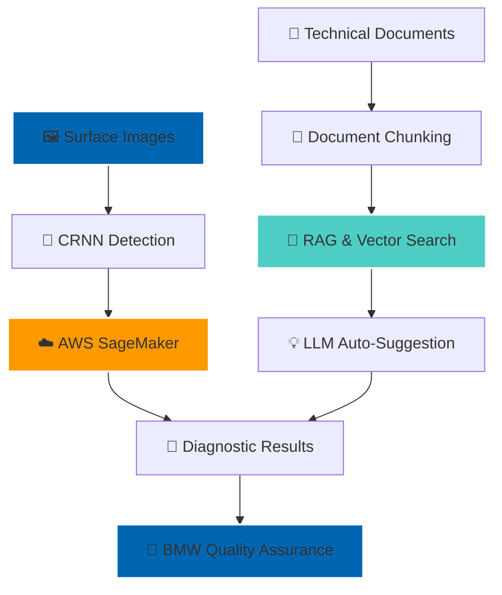
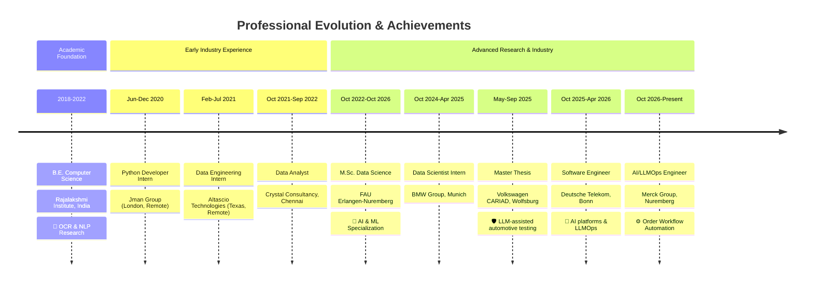

# Hi there! 👋 I'm Morris Darren Babu

---

## 💫 **About Me**

<table>
<tr>
<td width="70%">

> *"I enjoy making complicated work feel simpler. My work brings together AI engineering, automation, and software systems—with a focus on building solutions people can rely on, not just demos that look good."*

### 🎯 **Professional Identity**
- 🤖 **AI/LLMOps Engineer** @ **Merck Group** — B2B contract
- ☁️ Building applied AI and order-workflow automation with cloud and enterprise systems
- 🧪 Previously: **Deutsche Telekom**, **Volkswagen Group (CARIAD)**, and **BMW Group**
- 🎓 **M.Sc. Data Science** @ Friedrich Alexander University Erlangen-Nuremberg
- 📍 **Nürnberg, Germany** 🇩🇪

</td>
<td width="30%">

GitHub may pause animated images based on each viewer's Accessibility settings.

### 🌐 **Quick Connect**
[LinkedIn](https://linkedin.com/in/morrisdarrenbabu) · [Email](mailto:morrisdarren357@gmail.com) · [GitHub](https://github.com/DARREN-2000) · [Portfolio](https://darren-dev.netlify.app/)

</td>
</tr>
</table>

---

## 🏢 **Deutsche Telekom — AI Platforms & LLMOps**

### 🔬 **LLM Infrastructure & Evaluation**

<table>
<tr>
<td width="50%">

### 🎯 **Key Contributions**
- 🧠 **LLM Benchmarking Framework** — Microservices on vLLM using GuideLLM (latency, throughput) and DeepEval (LLM-as-judge), tracking experiments in ClearML for SLOs
- 🔄 **Scaled Automated Benchmarking** — GitLab CI/CD & Kubernetes runners, containerized matrix jobs on Hugging Face datasets, reports published to Grafana
- 🔐 **Secured Enterprise MLflow** — Kubernetes deployments with Keycloak OIDC & OAuth sidecars for SSO, ingress, TLS, and RBAC compliance

</td>
<td width="50%">

### 🏆 **Technologies**
vLLM · GuideLLM · DeepEval · ClearML · MLflow · Keycloak · Kubernetes (Helm) · GitLab CI/CD · Grafana · Docker

</td>
</tr>
</table>

---

## 🛡️ **Master Thesis @ CARIAD (Volkswagen Group)**

### 🔬 **Integrating LLMs In Automotive Systems**

<table>
<tr>
<td width="50%">

### 🎯 **Research Vision**
My thesis explored whether **Large Language Models** could help generate fuzz drivers for automotive C++ software—and how to evaluate and integrate that work into secure CI/CD/CT pipelines.

### 🔬 **Core Research Contributions**
- 🧠 **LLM-Assisted White-Box Fuzzing** — Benchmarked 16 LLMs for automotive C++ software
- 🔄 **Automated Test-Case Generation** — Integrated containerized LLM inference into CI/CD/CT
- 🔐 **Secure Azure Private Link** — Enabled inference from isolated CI/CD runners

</td>
<td width="50%">

### 🏆 **Quantifiable Impact**
- 🎯 **+13% code-flaw detection** via Azure AI Foundry
- ⚡ **-33% test creation time** through automation
- 🔋 **-55% token consumption** through model and workflow optimization
- 🛡️ **+7% code coverage** increase

</td>
</tr>
</table>

---

## 🔵 **BMW Group — Data Scientist Intern | RAG & LLM Systems**

### 🤖 **Automotive Diagnostics with RAG & LLM Systems**

<table>
<tr>
<td width="50%">

### 🎯 **Key Contributions**
- 🎯 **CRNN Surface Detection** — Deployed on AWS SageMaker (EC2, S3) with semantic segmentation for automated surface defect identification
- 🌐 **Django Web Application** — Parsing geometric STL meshes & file ingestion for 3D model analysis
- 🤖 **LLM Auto-Suggestion Model** — RAG & vector search for part issue identification, cutting false positives
- 📡 **Document Chunking Pipelines** — Data indexing for precision enhancement across diagnostic workflows
- ☁️ **API-Served Results** — Tuned AI parameters for production-ready automotive diagnostics

</td>
<td width="50%">

### 🏆 **Quantifiable Impact**
- 🎯 **+12% diagnostic precision** via RAG & vector search
- ⚡ **+8% faster processing** through document chunking
- ☁️ **AWS SageMaker** production deployment
- 🖼️ **Semantic segmentation** for surface detection

</td>
</tr>
</table>

**🛠️ Technologies:** AWS SageMaker · EC2 · S3 · RAG · Django · Semantic Segmentation · LLMs · Python · TensorFlow

---

## 🚀 **Professional Journey & Career Highlights**

### 📈 **Career Impact Visualization**

---

## 💻 **Comprehensive Technology Arsenal**

**Applied AI & LLMs:** Python, PyTorch, TensorFlow, RAG, LLM evaluation, vLLM, Hugging Face, LangChain, computer vision

**Cloud & Platforms:** AWS, Azure, Kubernetes, Docker, Helm, GitHub Actions, GitLab CI/CD

**LLMOps & Observability:** MLflow, ClearML, Keycloak, Grafana, DeepEval, GuideLLM

**Data & Software:** SQL, Spark, Snowflake, Databricks, SAP, TypeScript, JavaScript, C++, R

---

## 🌟 **Featured Project Portfolio**

### 🎯 **Research & Development Showcase**

<table>
<tr>
<td align="center" width="100%">

#### 🧠 **1. Inference Control Plane**
**🔬 Production-oriented LLM orchestration platform**
[Repository](https://github.com/DARREN-2000/Inference-Control-Plane)
🛠️ **Tech:** TypeScript
🎯 **Impact:** Dynamic model routing, intelligent fallback handling, semantic caching, and real-time observability across models.
💡 **Innovation:** GPU-aware vLLM scheduling and privacy-safe SLIs.

</td>
</tr>
<tr>
<td align="center" width="100%">

#### 🤖 **2. governOS**
**🔬 Agentic AI Planning & Orchestration System**
[Repository](https://github.com/DARREN-2000/governOS)
🛠️ **Tech:** TypeScript
🎯 **Impact:** A universal action OS that compiles natural-language intent into trusted workflows.
💡 **Innovation:** Schema validation, human approval gates, audit tracing, and real-time replanning.

</td>
</tr>
<tr>
<td align="center" width="100%">

#### 📦 **3. AgentBox**
**🔬 Secure WebAssembly Runtime for AI Agents**
[Repository](https://github.com/DARREN-2000/AgentBox)
🛠️ **Tech:** Rust, Wasmtime, Axum, React, TailwindCSS
🎯 **Impact:** An airtight Wasm sandbox that executes AI-generated code securely with fuel limits and memory isolation.
💡 **Innovation:** Native MCP (Model Context Protocol) Server for dynamic tool synthesis.

</td>
</tr>
<tr>
<td align="center" width="100%">

#### ⚡ **4. AI Hypervisor Platform**
**🔬 AI-native virtualization platform**
[Repository](https://github.com/DARREN-2000/ai-hypervisor-platform)
🛠️ **Tech:** Go, KVM/QEMU
🎯 **Impact:** GPU-aware inference workloads, automated VM provisioning, and workload isolation.
💡 **Innovation:** Designed for scalable AI orchestration.

</td>
</tr>
<tr>
<td align="center" width="100%">

#### 🛡️ **5. GuardrailX**
**🔬 Enterprise AI Governance Platform**
[Repository](https://github.com/DARREN-2000/GuardrailX)
🛠️ **Tech:** TypeScript
🎯 **Impact:** Enforces runtime LLM governance across enterprise systems.
💡 **Innovation:** Prompt injection detection, PII redaction, content safety filtering.

</td>
</tr>
<tr>
<td align="center" width="100%">

#### 🏭 **6. Rulvanta**
**🔬 Real-Time Predictive Maintenance & MLOps**
[Repository](https://github.com/DARREN-2000/Rulvanta)
🛠️ **Tech:** Python, Kafka, PySpark, FastAPI
🎯 **Impact:** Event-driven industrial predictive maintenance targeting sub-100ms p95.
💡 **Innovation:** Risk prediction, drift detection, and adaptive retraining.

</td>
</tr>
<tr>
<td align="center" width="100%">

#### 🎙️ **7. Kairith**
**🔬 Real-Time Voice Agent Runtime**
[Repository](https://github.com/DARREN-2000/kairith)
🛠️ **Tech:** Python, voice AI
🎯 **Focus:** Natural turn-taking, interruption handling, and reliable low-latency conversations.
💡 **Exploration:** Voice-agent runtime design and evaluation.

</td>
</tr>
</table>

---

## 🔬 **Detailed Professional Experience**

🧪 <strong>Merck Group</strong> — AI/LLMOps Engineer | B2B contract | <em>October 2026 – Present, Nuremberg</em>

**Current focus:** Applying LLMs and cloud automation to order workflows.

- Evaluating LLM-assisted document extraction and how to handle uncertain results.
- Mapping current processes and regional requirements for workflow expansion.
- Contributing to AWS-based automation, SAP integration, user testing, and release fixes.

💎 <strong>Crystal Consultancy Services</strong> — Data Analyst | <em>October 2021 – September 2022, Chennai, India</em>

### 📊 **Enterprise Business Intelligence & Analytics**

<table>
<tr>
<td width="50%">

**🔬 Analytical Contributions:**
- 📊 **SAP R3 KPI Monitoring** — Data-driven performance optimization
- ⚡ **Azure Databricks ETL** — Pipeline speed enhancement
- 📈 **Feature Engineering** — Model deployment optimization
- 💼 **Data-Driven Decisions** — Targeted business impact

</td>
<td width="50%">

**📈 Organizational Impact Metrics:**
- 📊 **+4% KPI improvement** through targeted decisions
- ⚡ **+25% ETL pipeline speed** via Azure Databricks
- 📈 **Optimized feature engineering** & model deployment
- 🎯 **Data quality improvement** initiatives

</td>
</tr>
</table>

**🛠️ Technologies:** SAP R3, Azure Databricks, Power BI, SQL, Python, Statistical Analysis

🏢 <strong>Altascio Technologies</strong> — Data Engineering Intern | <em>February 2021 – July 2021, Texas, USA (Remote)</em>

### ⚙️ **Data Engineering & Process Automation**

<table>
<tr>
<td width="50%">

**🔬 Engineering Solutions:**
- 📊 **Excel Automation** — VBA, Pivot Tables, VLOOKUP, SUMIFS
- 🗃️ **SQL Data Consolidation** — Fragmented inventory integration
- 🔄 **ETL Process Optimization** — Data pipeline development
- 📈 **Report Generation Automation** — Manual effort reduction

</td>
<td width="50%">

**📈 Operational Efficiency Gains:**
- ⏰ **20 hours/week** automation savings
- 📈 **-2% report generation time** reduction
- 🗃️ **-11% inventory update time** improvement
- 🔄 **Streamlined workflows**

</td>
</tr>
</table>

**🛠️ Technologies:** SQL, Excel (VBA, Pivot, VLOOKUP, SUMIFS), Data Consolidation, Python

🟢 <strong>Jman Group</strong> — Python Developer Intern | <em>June 2020 – December 2020, London, UK (Remote)</em>

### 🤖 **Predictive Modeling & Data Science**

<table>
<tr>
<td width="50%">

**🔬 Technical Contributions:**
- 🤖 **Predictive Models** — ML algorithms using sensor data
- 📡 **Field Testing** — 87% accuracy in real-world tests
- 🔄 **End-to-End Data Science** — Solved ETL pipeline bottlenecks
- 📈 **Throughput Optimization** — Pipeline performance enhancement

</td>
<td width="50%">

**📈 Measurable Impact:**
- 🎯 **87% accuracy** in field tests
- 🔄 **ETL bottleneck resolution**
- 📊 **End-to-end** pipeline delivery

</td>
</tr>
</table>

**🛠️ Technologies:** Python, ML Algorithms, Sensor Data Processing, ETL Pipelines

---

## 🎓 **Academic Excellence & Professional Certifications**

### 📚 **Educational Foundation**

<table>
<tr>
<td width="50%" align="center">

#### 🎓 **Master of Science in Data Science**
**Friedrich Alexander University Erlangen-Nuremberg**
**🇩🇪 Germany | October 2022 – October 2026**

**🔬 Core Specializations:**
- Pattern Recognition & Computer Vision
- Deep Learning & Neural Networks
- Generative Artificial Intelligence
- Anomaly Detection & Decision Theory
- Reinforcement Learning & Statistics
- Machine Learning in Finance

</td>
<td width="50%" align="center">

#### 🎓 **Bachelor of Engineering in Computer Science**
**Rajalakshmi Institute of Technology**
**🇮🇳 India | June 2018 – June 2022**

**🏆 Achievement:** Graduated with Excellence
**💻 Technical Foundation:**
- Data Structures & Algorithms
- Database Management Systems
- Software Engineering Principles
- Machine Learning Fundamentals
- Computer Networks & Security

</td>
</tr>
</table>

### 🏆 **Professional Certifications Portfolio**

<table>
<tr>
<td width="50%" align="center">

**📊 Data Science & Analytics Mastery**

- 📈 **Excel to MySQL: Regression Statistics**
- 🎓 **Predictive Data Analytics for BI Nanodegree**
- 🔍 **Data Warehousing, Big Data on GCP**

</td>
<td width="50%" align="center">

**☁️ Cloud Computing & AI/ML Excellence**

- 🌐 **Google Cloud Platform IT Automation**
- 🧠 **DL AI TensorFlow Developer**

</td>
</tr>
</table>

**📄 Documents:** [Transcripts, degree certificates, and certifications](https://github.com/DARREN-2000/Documents)

---

## 🌍 **Global Communication & Language Proficiency**

English (C1) · German (A2, currently studying B1) · French (A1) · Tamil (native)

---

## 🎯 **Research Publications & Academic Impact**

### 📝 **Publication Portfolio & Research Contributions**

<table>
<tr>
<td width="50%">

#### 🎬 **Movie Recommendation System using Hybrid Filtering**
**Principal Author:** Morris Darren Babu
**Publication Year:** 2022
**Research Impact:** Advanced ML & Recommendation Systems

**🔬 Key Research Innovations:**
- 🎯 **Hybrid Filtering** — Collaborative + Content-based
- 🔄 **Advanced Clustering** — Enhanced user segmentation
- 💻 **Flask Web Application** — Real-time recommendations

**📄 Repository:** [*Hybrid-Movie-Recommendation-System*](https://github.com/DARREN-2000/Hybrid-Movie-Recommendation-System)

</td>
<td width="50%">

#### 🔍 **Advanced Data Engineering for Economic Forecasting**
**Research Collaboration:** OSS Research Group
**Project Duration:** 6-month intensive research
**Academic Impact:** Economic Data Science Applications

**🔬 Breakthrough Research Achievements:**
- 📈 **Germany GDP Prediction** — Historical analysis (1970-2022)
- 🔗 **Inflation-GDP Correlation** — 85% statistical reliability
- ⏱️ **Time-series Engineering** — Advanced forecasting
- 📊 **Economic Modeling** — Predictive analytics

**📄 Research Documentation:** [*Project Repository*](https://github.com/DARREN-2000/Documents)

</td>
</tr>
</table>

---

## 🤝 **Professional Network & Collaboration Hub**

### Building useful, dependable AI systems—one thoughtful engineering decision at a time.

